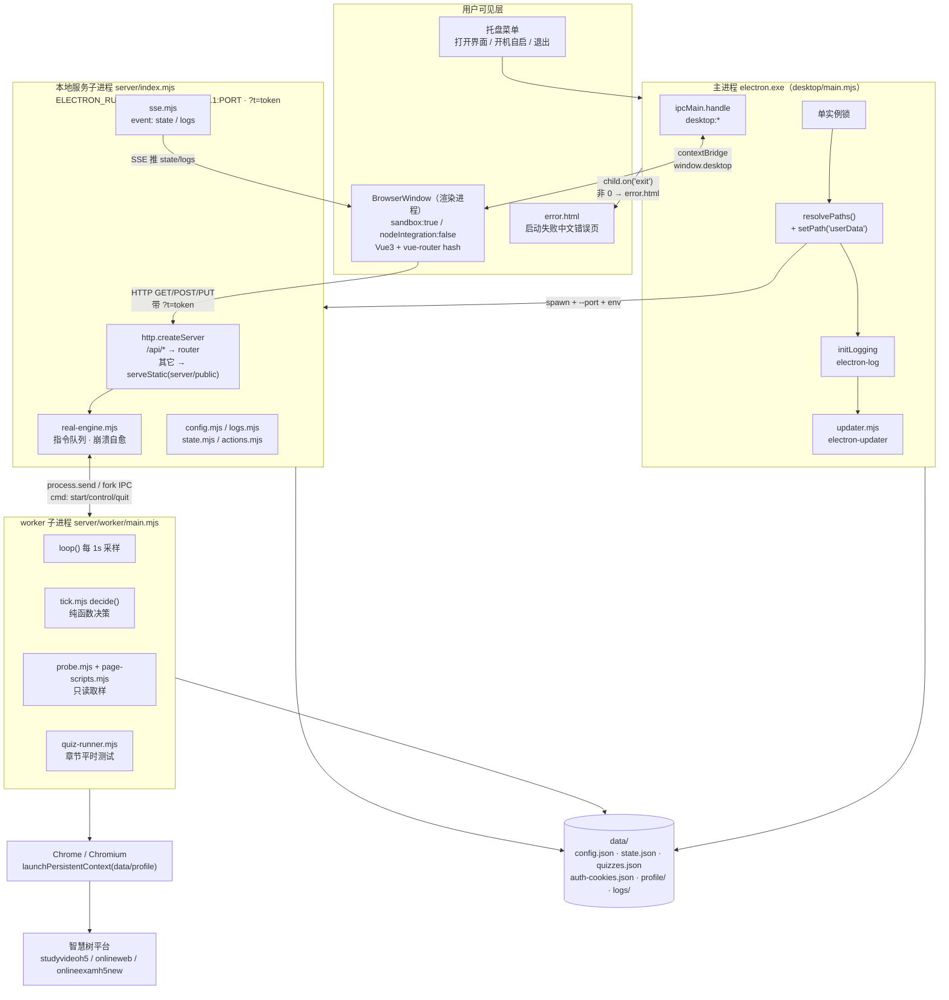
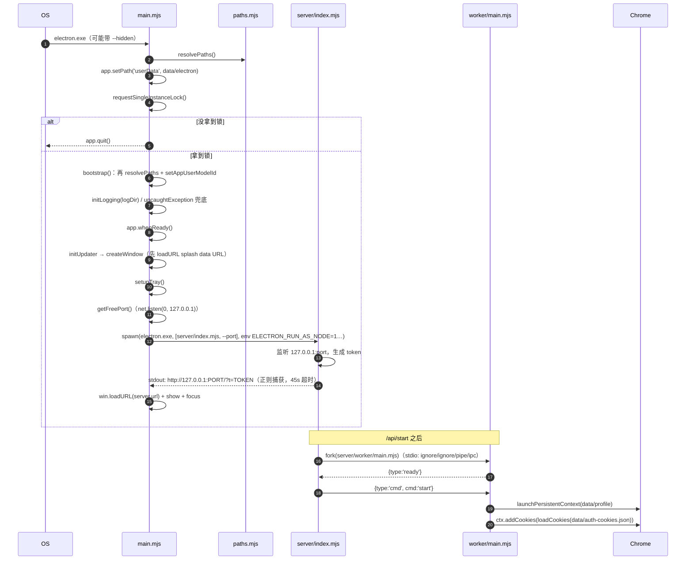
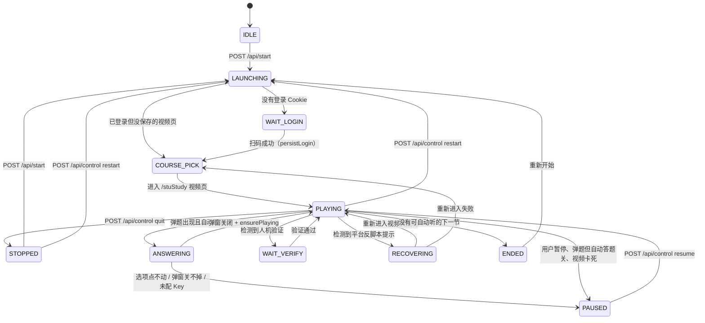
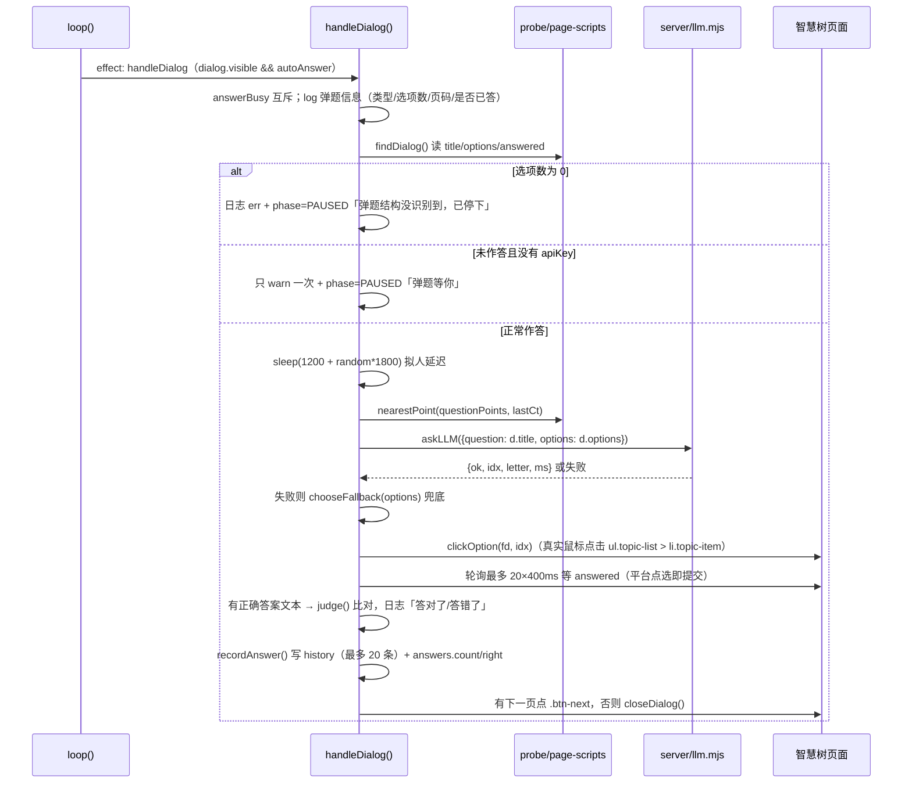

# 智慧树自动听课 · 架构说明

> 适用版本：`0.1.0`（`package.json`）。本文描述**当前代码实际形态**，不是设计日志。
> 早期设计稿见 [`docs/DESIGN.md`](./DESIGN.md)，其中部分章节（`start.bat`、`server/src/`、跨进程 supervisor 等）已被实现取代；
> 凡两者冲突处，一律以源码为准，偏差清单见 [§14](#14-文档与代码的偏差docsdesignmdreadmemd)。

---

## 目录

1. [一句话定位与关键约束](#1-一句话定位与关键约束)
2. [技术栈与依赖](#2-技术栈与依赖)
3. [总体架构](#3-总体架构)
4. [进程模型与生命周期](#4-进程模型与生命周期)
5. [模块地图](#5-模块地图)
6. [核心数据流](#6-核心数据流)
7. [HTTP API 清单](#7-http-api-清单)
8. [数据与存储](#8-数据与存储)
9. [反检测设计原则](#9-反检测设计原则)
10. [打包与交付](#10-打包与交付)
11. [测试策略](#11-测试策略)
12. [关键设计决策与权衡](#12-关键设计决策与权衡)
13. [已知限制与技术债](#13-已知限制与技术债)
14. [文档与代码的偏差](#14-文档与代码的偏差docsdesignmdreadmemd)

---

## 1. 一句话定位与关键约束

**一句话**：一个自带 Node 运行时和 Chromium 的 Windows 桌面程序 —— Electron 主进程拉起一个只监听
`127.0.0.1` 的本地服务（`server/index.mjs`），服务再 `fork` 一个独占浏览器的 worker，用 Playwright 驱动
真实 Chrome 在智慧树页面上自动播放、自动作答弹题、自动交章节平时测试；界面是同机的 Vue 单页，通过 HTTP + SSE 与服务通信。

整个程序没有后端服务器：**平台侧看到的浏览器行为来自本机 Chrome，所有状态留在本机 `data/` 目录**。

| 约束 | 实现落点 | 说明 |
| --- | --- | --- |
| 仅 Windows x64 | `electron-builder.yml` → `win.target: portable + zip` / `arch: [x64]` | 隐藏浏览器窗口依赖 `server/worker/win-window.ps1`（PowerShell + `user32.dll` 的 `SetWindowLong/SetWindowPos`），非 Windows 无等价实现 |
| 单实例 | `desktop/main.mjs` → `app.requestSingleInstanceLock()` | 拿不到锁直接 `app.quit()`；第二个实例触发 `second-instance`，只把已有窗口 show/restore |
| 只监听 127.0.0.1 | `server/index.mjs` → `server.listen(PORT, '127.0.0.1')` | 端口由主进程动态分配，默认 8731 只在直接 `node server/index.mjs` 时使用 |
| 路由层强制 token | `server/lib/router.mjs` → `url.searchParams.get('t') === token` | token 每次启动 `crypto.randomBytes(12)` 重新生成（24 位 hex），不落盘到固定配置 |
| `data/` 自包含 | `desktop/paths.mjs` → `resolvePaths()` + `desktop/paths-plan.mjs` → `planRuntime()` | 先判运行形态（`dev` / `portable-file` / `portable-dir` / `temp-exe` / `installed`）再给候选目录；`ZHS_DATA` 永远优先，其次程序所在目录的 `data/`，最后 `%APPDATA%\ZhihuishuAuto\data`。配置、登录态、断点、日志、缓存全在里面 |
| 免安装、免管理员 | `electron-builder.yml` → `win.target: [portable, zip]`、`portable.requestExecutionLevel: user` | 单文件 exe 自解压到独立 `%TEMP%` 子目录运行、退出即清理（数据靠 `PORTABLE_EXECUTABLE_DIR` 写回程序目录）；zip 版解压即用。**程序必须放在可写目录**（别放 `Program Files`） |
| 不注入页面脚本 | `server/worker/lib/page-scripts.mjs` | 只做只读 `page.evaluate`，不装 `MutationObserver`、不改 DOM |

---

## 2. 技术栈与依赖

版本取自 `package.json`（`^` 语义化范围，实际安装以 `package-lock.json` 为准）。

| 依赖 | 版本 | 类别 | 在本项目里的用途 | 主要出现位置 |
| --- | --- | --- | --- | --- |
| `electron` | `^45.0.0` | devDependency | 桌面壳；同时充当**服务端/worker 的 Node 运行时**（`ELECTRON_RUN_AS_NODE=1`） | `desktop/*`，`desktop/server-process.mjs` |
| `electron-builder` | `^26.15.3` | devDependency | 打 Windows **免安装**产物（portable 单文件 exe / zip 目录版）、`extraResources`、asar 开关 | `electron-builder.yml`、`npm run dist` |
| `electron-updater` | `^6.8.9` | dependency | 更新检查/下载/安装（`provider: generic`）；**免安装形态下直接禁用**（`portable` 目标不产出 update info） | `desktop/updater.mjs` |
| `electron-log` | `^5.4.4` | dependency | 主进程日志 + server 日志（打包版 `logs/server.log`）、未捕获异常落盘、文件轮转 | `desktop/logging.mjs`、`server/lib/logs.mjs` |
| `playwright` | `^1.64.1` | dependency | `chromium.launchPersistentContext()` 驱动真实 Chrome / 内置 Chromium | `server/worker/main.mjs` |
| `adm-zip` | `^0.6.1` | dependency | 「导出日志」打 zip | `desktop/logging.mjs` → `exportLogs()` |
| `vue` | `^3.5.12` | devDependency | 界面框架 | `web/src/**` |
| `vue-router` | `^4.6.4` | devDependency | hash 路由（`createWebHashHistory`，保住 `?t=`） | `web/src/router.js` |
| `vite` | `^5.4.10` | devDependency | 前端构建到 `server/public/` | `web/vite.config.js` |
| `@vitejs/plugin-vue` | `^5.1.4` | devDependency | SFC 编译 | `web/vite.config.js` |
| `prettier` | `^3.3.3` | devDependency | `npm run format` / `format:check` | 根目录 |
| `node:test` | 内置 | — | `npm test` = `node --test`，15 个纯函数单测 | `test/*.test.mjs` |

设计上的几条技术选择，读代码时值得先知道：

- **服务端零框架**：`server/index.mjs` 只用 Node 内置 `http`/`fs`/`path`/`net`/`crypto`，路由是手写数组 + `server/lib/router.mjs`；SSE 是手写 `text/event-stream` 帧（`server/lib/sse.mjs`），没有 express/socket.io。
- **前端零 UI 库**：纯 Vue SFC + 手写 CSS（`web/src/style.css`、`app.css`），没有组件库；图标用 emoji/内联 SVG。
- **构建产物是关键路径**：`web/` 只是源码，运行时静态文件根是 `server/public/`；`serveStatic()` 找不到 `index.html` 时会提示「请先执行 npm run web:build 生成前端」。

---

## 3. 总体架构



三条链路要点：

1. **界面 ↔ 服务**：同机 HTTP。`web/src/api.js` 从 `location.search` 取 `t` 拼到每个请求上；`EventSource('/api/events?t=…')` 是唯一的推送通道，`App.vue` 是唯一的订阅点，状态进了 `web/src/store.js` 的单例。
2. **服务 ↔ worker**：`child_process.fork` + IPC 消息（`{type:'cmd'|'state'|'log'|'ready'}`），不是 HTTP。服务只做「状态聚合 + 指令转发 + 自愈」，**所有 Playwright 调用都在 worker 里**。
3. **worker ↔ 平台**：一个持久化 Chrome 上下文，持久化目录就是 `data/profile/`，所以 Cookie/登录态天然复用；会话 Cookie 另外存 `data/auth-cookies.json` 兜底（见 [§8](#8-数据与存储)）。

---

## 4. 进程模型与生命周期

### 4.1 进程清单

| 进程 | 入口 | 数量 | 职责 | 谁拉起 |
| --- | --- | --- | --- | --- |
| main | `desktop/main.mjs` | 1（单实例锁保证） | 窗口、托盘、开机自启、IPC、日志、更新、拉起/停止本地服务 | Electron 自身 |
| server | `server/index.mjs` | 1 | HTTP + SSE + 静态文件、配置读写、状态聚合、引擎编排、崩溃自愈 | `desktop/server-process.mjs` → `spawn(process.execPath, [entry, '--port', port])` |
| worker | `server/worker/main.mjs` | 0 或 1 | 独占浏览器：登录、选课、选节、播放、弹题作答、章节测试 | `server/real-engine.mjs` → `fork()` |
| 浏览器 | Chrome/Chromium | 1 个持久化上下文 | 真正与平台交互的载体（`headless:false`，窗口被移出屏幕） | worker → `chromium.launchPersistentContext(PROFILE, …)` |

没有渲染进程里跑引擎这种形态：渲染进程 `sandbox:true`、`nodeIntegration:false`，只能通过 `contextBridge` 暴露的 `window.desktop` 走 IPC。

### 4.2 启动顺序（顺序不能乱）

`desktop/main.mjs` 顶部注释明确写了原因：**任何读取或隐式创建 `userData` 的调用，如果发生在 `setPath('userData')` 之前，Windows + Electron 45 上主进程会静默退出**（无窗口、无报错、无日志）。



关键细节：

- `--hidden` 出现在 `process.argv` 时（开机自启），`ready-to-show` 后不 show 窗口，程序只进托盘。
- 启动页是先 `loadURL(SPLASH)`（内联 `data:` URL，深色，「正在启动本地服务…」），拿到服务地址后再 `loadURL(server.url)`，所以用户不会看到白屏。
- `startServer()` 在 `stdout` 上匹配 `/http:\/\/127\.0\.0\.1:\d+\/\?t=[a-f0-9]+/`；45 秒没匹配到 → reject「本地服务启动超时（45 秒）」。
- `stderr` 保留最近 4000 字符，进错误页/日志。
- 启动第一条日志同时记录运行形态：`应用启动 v<版本>（<modeLabel>）`、`启动程序：<launchExe>`、`数据目录：<dataDir>`；形态是 `temp-exe` 时额外 warn 建议把程序解压到固定目录。

### 4.3 端口与 token 协商

| 环节 | 实现 |
| --- | --- |
| 端口 | 主进程 `getFreePort()` 绑定 `listen(0, '127.0.0.1')` 拿系统分配端口，再 `--port` 传给子进程；server 里 `PORT = Number(argv.port) \|\| 8731` |
| token | server 启动时 `crypto.randomBytes(12).toString('hex')`（24 位 hex），只存在于内存；路由层校验 `?t=`，不匹配 403「访问令牌无效」 |
| 地址交换 | server 在 `listen` 回调里写 `data/server.url`（内容就是完整带 token 的 URL），主进程则从 stdout 正则拿，不依赖文件 |
| 前端带 token | `web/src/api.js` 的 `api()` / `subscribe()` 统一拼 `?t=`；hash 路由保证切页不丢 query；`authUrl()` 给 `` 之类本地资源补 token |

### 4.4 停止、崩溃自愈

两级看护：

**A. 主进程看 server**（`desktop/main.mjs`）

- 正常退出：`before-quit` → `quitting = true` → `stopLocalServer()` → `tray.destroy()`。
- 强制停止：`stopServer()` 先 `SIGTERM`，5 秒后 `taskkill /pid <pid> /T /F`（命令本身在代码里）（Windows 的子进程树对 SIGTERM 不一定买账）。
- 意外退出：`child.on('exit')` 里若 `!quitting && child === current && code !== 0` → 加载 `error.html`，文案「本地服务意外退出（code=…），点「重试」重新启动」；重试走 IPC `desktop:retryServer`。

**B. server 看 worker**（`server/real-engine.mjs`）

- `crashTimes` 只保留 1 小时内的崩溃时间戳；本次 push 后 `length > 3`（即 1 小时内第 4 次）→ `wantRunning = false` + 补丁 `{phase:'STOPPED', notice:'连续异常退出了 4 次，已停止自动恢复…'}`。
- 否则补丁 `{phase:'LAUNCHING', notice:'后台异常退出，正在自动恢复（第 N 次）…'}` + 日志 warn + **4000 ms 后**重新 `spawnWorker()` 并 `send('start')`。
- `expectExit` 标记用于「主动重启旧 worker」：`start()` 发现旧 child 还在时先等它 exit，避免两个 worker 抢同一个 Chrome profile。
- worker 的 `stderr` 最近 2 行以 `debug` 级别进日志（截 240 字），便于定位「浏览器起不来」。
- 指令在 worker 未就绪时进队列（上限 50），`ready` 后按顺序 flush。

### 4.5 窗口 / 托盘 / 开机自启 / 退出

| 能力 | 实现 |
| --- | --- |
| 窗口 | 默认 1440×900（`data/window.json` 有记录则恢复），最小 1180×720，`show:false` + `backgroundColor:'#0f1117'`，`autoHideMenuBar`，`Menu.setApplicationMenu(null)` |
| 关窗不退出 | `close` 事件里若 `!quitting` → `preventDefault()` + 保存 bounds + `hide()`；`window-all-closed` 什么都不做 |
| 位置记忆 | `resize`/`move` 去抖 600 ms 写 `window.json` |
| 托盘 | `createTray()`：打开界面 / 开机自动启动（checkbox，回调 `getAutoStart`/`setAutoStart`）/ 退出；单击、双击也打开界面 |
| 开机自启 | `app.setLoginItemSettings({ openAtLogin, path: autoStartPath(), args: ['--hidden'] })`，`autoStartPath() = paths.launchExe`（单文件版必须是原始 exe，不能是 `%TEMP%` 里的 `process.execPath`），写完用 `getLoginItemSettings` 回读校验；开发模式不写系统项，返回 `{ok:true, enabled, note:'开发模式不写开机自启'}` |
| 退出 | `desktop:quitApp` → `quitting = true` + `app.quit()`（会走 `before-quit` 停服务） |
| 重启 | `desktop:restartApp` → `stopLocalServer()` + `quitting = true`；`portable-file` 形态走 `relaunchAfterExit(paths.launchExe)`（`ping -n 5` 延迟 5 秒再 `start` 原始 exe，等启动器清理完 `%TEMP%`），其它形态 `app.relaunch({ execPath: paths.launchExe, args: 去掉 --hidden })` + `app.exit(0)` |
| 启动失败 | `error.html?msg=…`；`friendly(e)` 把 `ENOENT`/`EACCES`/超时翻译成中文文案 |

### 4.6 IPC 通道（`desktop/preload.cjs` ↔ `desktop/main.mjs`）

全部 `ipcMain.handle`，统一 `guard()` 包 try/catch，失败返回 `{ok:false, message}`。渲染进程侧封装在 `web/src/store.js`，浏览器调试版自动降级为提示「浏览器版不支持…，请用桌面版」。

| 通道 | 作用 |
| --- | --- |
| `desktop:openDataDir` | `shell.openPath(dataDir)` |
| `desktop:openPath` | 打开 `data/` 内的文件或目录（`underData()` 校验路径必须在 `dataDir` 内） |
| `desktop:exportLogs` | 调 `exportLogs()` 打 zip，返回 `{ok, path, logFiles}` |
| `desktop:checkUpdate` / `desktop:installUpdate` | 检查更新 / 下载并安装 |
| `desktop:restartApp` | 重启程序（过滤 `--hidden`） |
| `desktop:quitApp` | 真正退出 |
| `desktop:retryServer` | 重新 `bootServer()` + `loadApp()`（错误页「重试」） |
| `desktop:getAutoStart` / `desktop:setAutoStart` | 读写开机自启（设置成功会重建托盘菜单） |

### 4.7 环境变量一览

| 变量 | 读取方 | 作用 |
| --- | --- | --- |
| `ZHS_DATA` | `desktop/paths.mjs`、`server/index.mjs`、`server/worker/main.mjs` | 指定数据目录（自检、多开、开发用），优先级最高 |
| `PORTABLE_EXECUTABLE_DIR` / `PORTABLE_EXECUTABLE_FILE` | `desktop/paths-plan.mjs`（经 `resolvePaths()` 传入） | 单文件免安装版由 electron-builder 启动器注入：前者是 exe 真实所在目录（`data/` 与 `launchExe` 都据此算），后者是原始 exe 路径 |
| `ZHS_LOG_DIR` | `server/lib/logs.mjs` | 有值则 server 日志写 `logs/server.log`（electron-log，5 MB 轮转）；无值退回 `data/runtime.log`（超过 2 MB 清空） |
| `ZHS_APP_VERSION` | `server/index.mjs` | 覆盖版本号（否则读 `package.json`） |
| `ZHS_DESKTOP=1` | `desktop/server-process.mjs` 注入 | 标记运行在桌面壳内 |
| `ZHS_DEBUG=1` | `server/index.mjs`、`server/worker/main.mjs` | 打开 `debugOnly` 控制指令，把弹窗结构/截图/接口响应写 `data/debug/` |
| `PLAYWRIGHT_BROWSERS_PATH` | `desktop/server-process.mjs` | 指向 `resources/browsers`（打包版）或仓库 `browsers/`（开发版） |
| `ZHS_UPDATE_URL` | `desktop/updater.mjs` | 更新源，优先级高于 `resources/update.json` |
| `TEMP` / `TMP` | `desktop/server-process.mjs` | 先探针测试可写，不可写则改成 `data/tmp` |

---

## 5. 模块地图

### 5.1 根目录

| 路径 | 职责 |
| --- | --- |
| `package.json` | ESM（`type: module`），`main: desktop/main.mjs`；脚本见 [§11](#11-测试策略) |
| `electron-builder.yml` | 打包配置，见 [§10](#10-打包与交付) |
| `README.md` | 面向使用者的说明（安装、界面、配置、限制） |
| `docs/DESIGN.md` | 设计稿与铁律；部分内容已过时，见 [§14](#14-文档与代码的偏差docsdesignmdreadmemd) |
| `desktop/` | Electron 主进程（桌面壳） |
| `server/` | 本地服务 + 引擎 + Playwright worker + 前端构建产物 |
| `web/` | Vue3 源码（四页界面 + 组件 + 领域函数） |
| `test/` | `node:test` 纯函数单测 |
| `scripts/` | 构建辅助、自检、开发工具 |
| `browsers/` | `npm run browsers:install` 准备的内置 Chromium（打包进 `resources/browsers`） |
| `release/` | 打包产物（`win-unpacked`、portable exe / zip） |
| `research/` | 逆向/协议调研资料（不参与运行） |

### 5.2 `desktop/` —— 桌面壳

| 文件 | 职责 | 关键导出 / 入口 |
| --- | --- | --- |
| `desktop/main.mjs` | 主进程入口（约 500 行，随迭代变化）：单实例锁、窗口、托盘、IPC、拉服务、运行形态日志、更新初始化 | `bootstrap()` / `onReady()` / `bootServer()` / `loadApp()` / `createWindow()` / `autoStartPath()` / `relaunchAfterExit()` / `friendly()` |
| `desktop/paths-plan.mjs` | 纯函数：判定运行形态、算数据目录候选、算自启/重启要拉起的 exe（不引 electron、不读写盘，可单测） | `planRuntime()` / `modeLabel()` / `samePath()` / `isTempDir()` / `isInstalledDir()` |
| `desktop/paths.mjs` | 调 `planRuntime()` 拿候选目录，写探针选可写的那个；派生 `logDir` / `electronDataDir` / `browsersDir` | `resolvePaths()` |
| `desktop/server-process.mjs` | 用 `electron.exe` + `ELECTRON_RUN_AS_NODE=1` 拉起 `server/index.mjs`，从 stdout 捞 URL，超时/强杀 | `getFreePort()` / `startServer()` / `stopServer()` |
| `desktop/logging.mjs` | electron-log 初始化、过期与超量清理（5 MB/文件、30 MB 总量、14 天）、apiKey 脱敏、导出 zip | `initLogging()` / `cleanOldLogs()` / `redactConfig()` / `exportLogs()` |
| `desktop/tray.mjs` | 托盘菜单与图标选择 | `createTray()` / `trayIconPath()` |
| `desktop/updater.mjs` | electron-updater 封装：源解析、状态机、25 秒检查超时；**免安装形态（`opts.isPortable`）直接 `disabled`** | `initUpdater()` / `checkForUpdates()` / `installUpdate()` / `updaterState()` |
| `desktop/preload.cjs` | `contextBridge` 暴露 `window.desktop`（`isDesktop`/`version` + 10 个 IPC 方法，全部 `ipcRenderer.invoke`） | `window.desktop.*` |
| `desktop/electron-api.mjs` | `createRequire` 取 Electron CJS 真身再按需再导出（ESM 静态导入命名导出不可靠） | `app` / `BrowserWindow` / `Tray` / `ipcMain` / `shell` / … |
| `desktop/error.html` | 启动失败中文错误页，「重试」「退出程序」 | `?msg=` |
| `desktop/update.json` | 更新源配置，`url` 留空 = 不检查更新 | — |
| `desktop/assets/` | `icon.ico` / `icon.png` / `tray.ico` / `tray.png` | — |

### 5.3 `server/` —— 本地服务与引擎

| 文件 | 职责 | 关键导出 / 入口 |
| --- | --- | --- |
| `server/index.mjs` | 组合根（334 行）：读环境、生成 token、装配 log/config/state/engine/hub/router、路由表（259–271 行）、静态文件、`listen('127.0.0.1')`、写 `data/server.url` | `routes` / `startTask` / `controlTask` / `updateSettings` / `getConfigOrSave` / `getQr` / `llmCheck` / `readCourses` / `pickCourse` / `pickLesson` |
| `server/state.mjs` | 前端可见状态初值与深合并 | `initialState()` / `applyPatch()` |
| `server/real-engine.mjs` | 真实引擎（237 行）：`fork` worker、指令转发与排队、状态/日志上抛、崩溃自愈 | `createRealEngine()` → `start()` / `ready()` / `control()` / `stop()` |
| `server/mock-engine.mjs` | 无浏览器 mock 引擎（410 行），用于界面联调与 selftest | `createMockEngine()`；`MOCK_LESSONS` / `MOCK_COURSES` / `MOCK_QUIZZES` |
| `server/llm.mjs` | OpenAI 兼容 chat 调用、判断题/字母抽取、多选题解析 | `askLLM()` / `askQuiz()` / `postChat()` / `pickLetter()` / `buildPrompt()` |
| `server/worker/main.mjs` | Playwright worker（2022 行），真正干活的地方 | `doStart()` / `loop()` / `handleDialog()` / `runQuiz()` / `launch()` / `ensureLogin()` / `ensureCourse()` / `clickLesson()` |
| `server/worker/win-window.ps1` | 隐藏/显示 Chrome 窗口（加 `WS_EX_TOOLWINDOW` + 移到 `-32000,-32000`） | `-Action hide\|show -ProfilePath <data/profile>` |
| `server/public/` | `web/` 的构建产物（`serveStatic()` 的 docroot） | `index.html` + `assets/*` |

### 5.4 `server/lib/` —— 服务层纯模块

| 文件 | 职责 | 关键导出 |
| --- | --- | --- |
| `server/lib/actions.mjs` | `/api/control` 的**允许清单**：守卫（`running`/`startable`/`any`）+ 乐观补丁 | `CONTROL` / `resolveControl()` / `actionPatch()` / `isStoppedPhase()` / `requireRunning()` |
| `server/lib/config.mjs` | `data/config.json` 读写：模板、mtime+size 缓存、tmp+rename 原子写、apiKey 脱敏 | `createConfigStore()` / `TEMPLATE` / `maskKey()` |
| `server/lib/http.mjs` | MIME 表、JSON 响应封装、带 `expose` 错误、body 读取（上限 1 MB）、静态文件（越界防护） | `json()` / `fail()` / `readJson()` / `serveStatic()` / `httpError()` |
| `server/lib/llm-check.mjs` | 「模型自检」：拿一道样题问模型，验证 Key/模型可用 | `runLlmCheck()` / `SAMPLE_CHECK` |
| `server/lib/logs.mjs` | 300 条环形日志缓冲 + 落盘（`server.log` / `runtime.log`）+ 变更回调 | `createLogRing()` |
| `server/lib/router.mjs` | 精确路径匹配 → token → method → 解析 body → handler；错误透出 | `createRouter()` |
| `server/lib/sse.mjs` | SSE 推送：帧格式、首帧补发、`state`/`logs` 去重与 60/200 ms 合并 | `createHub()` |

### 5.5 `server/worker/lib/` —— worker 的可测部分

| 文件 | 职责 | 关键导出 |
| --- | --- | --- |
| `server/worker/lib/tick.mjs` | **决策核心**（188 行纯函数）：喂观测 + 记忆 + 配置，吐流程/补丁/日志/动作 | `decide(obs, mem, cfg)` → `{flow, mem, patches, logs, effects}`；`INITIAL_MEM` |
| `server/worker/lib/probe.mjs` | 帧适配层：在 `page.frames()` 里找弹窗/视频/提示弹窗，包一层 `evaluate` | `createProbe()` → `findDialog` / `findVideo` / `pageState` / `readCourseTree` / `readCourseList` / `dialogHtml` / `scanNotices` |
| `server/worker/lib/page-scripts.mjs` | 被序列化进页面执行的**只读**脚本与选择器常量（不能引用模块作用域） | `DIALOG_BOX_CSS` / `PLAY_BUTTON_CSS` / `VSTATE` / `DIALOG` / `COURSE_TREE` / `ABNORMAL` / `VERIFY` / `COURSE_LIST` / `NOTICES` |
| `server/worker/lib/notice.mjs` | 提示类弹窗（学前必读等）的纯逻辑判定：关不关、点哪个按钮 | `isNotice()` / `isBlocked()` / `planNoticeClose()` / `noticeLabel()` |
| `server/worker/lib/question-points.mjs` | 弹题点列表合并与定位 | `mergePoints()` / `toStateList()` / `nearestPoint()` / `markAnswered()` / `nextQuestionOf()` |
| `server/worker/lib/answer-strategy.mjs` | 无 Key/无选项时的兜底选择、答案比对、历史记录 | `chooseFallback()` / `labelOf()` / `judge()` / `summaryOf()` / `historyEntry()` |
| `server/worker/lib/quiz-logic.mjs` | 章节测试的题型判定、提示词、字母解析、章节分组 | `buildQuizPrompt()` / `chooseLetters()` / `fallbackIdxs()` / `groupChapters()` / `pickChapterToQuiz()` / `quizListOf()` |
| `server/worker/lib/quiz-runner.mjs` | 章节测试执行器（543 行）：开卷、逐题作答、翻页、提交、关页 | `createQuizRunner(deps)` → `run(key, {noSubmit})` |
| `server/worker/lib/quiz-scripts.mjs` | 考试页（`onlineexamh5new.zhihuishu.com`）只读提取脚本 | `QUIZ_PAPER` / `QUIZ_RESULT` |
| `server/worker/lib/quiz-store.mjs` | `data/quizzes.json` 读写（tmp+rename） | `loadQuizzes()` / `saveQuizzes()` |
| `server/worker/lib/session-store.mjs` | 会话 Cookie 落盘/恢复（会话 Cookie 关浏览器即失效） | `saveCookies()` / `loadCookies()` / `pickCookies()` / `cookiesPath()` |

### 5.6 `web/` —— 界面

| 路径 | 职责 |
| --- | --- |
| `web/src/main.js` | `createApp(App).use(router).mount('#app')` |
| `web/src/App.vue` | 外壳：顶部导航、课程胶囊、连接状态、操作按钮组、提示条、toast；`onMounted(init)` / `onBeforeUnmount(destroy)`，**全应用唯一的 SSE 订阅点** |
| `web/src/store.js` | 模块级单例（374 行）：状态、日志、派生 computed、所有 HTTP 动作、桌面能力封装 |
| `web/src/api.js` | 带 token 的 fetch 封装、错误翻译、`subscribe()` 建 EventSource |
| `web/src/router.js` | `createWebHashHistory`，`/` `/courses` `/settings` `/logs` |
| `web/src/domain/format.js` | `PHASE_LABEL`、`pctText`、`barW`、`fmtClock`、`lessonStat` |
| `web/src/domain/next-question.js` | 用 `state.video.ct` + `questionPoints` 本地推算下一题倒计时（不再依赖 worker 推的 `nextQuestion`） |
| `web/src/composables/useAction.js` | `useAction()` / `makeToggle()`（开关按钮通用逻辑） |
| `web/src/pages/Overview.vue` | 总览：一屏仪表盘（CourseHero + LessonTree + NextQuestion + AutoPanel + ChapterQuiz + BottomDock） |
| `web/src/pages/Courses.vue` | 选课：我的课程 / 当前课程 / 全量目录 |
| `web/src/pages/Settings.vue` | 设置：模型配置表单、自检、自动化开关、桌面能力按钮（`openDataDir`/`exportLogs`/`setAutoStart`/`checkUpdate`/`installUpdate`/`restartApp`） |
| `web/src/pages/LogsPage.vue` | 日志：级别筛选、关键字、自动滚动、清屏游标、导出 |
| `web/src/components/` | `CourseHero` `ProgressOverview` `LessonTree` `NextQuestion` `AutoPanel` `ChapterQuiz` `CoursePicker` `LoginOverlay` `BottomDock` |
| `web/vite.config.js` | `root: web/`、`outDir: server/public/`、开发代理 `/api` → `127.0.0.1:8731` |

### 5.7 `test/` 与 `scripts/`

| 路径 | 职责 |
| --- | --- |
| `test/*.test.mjs`（15 个） | 纯函数单测，见 §11.1 |
| `test/fixtures/dialog-open.html` / `dialog-answered.html` / `notice-prelecture.html` | 弹窗页内脚本的真实 DOM 夹具（被 `page-scripts.test.mjs` / `notice-page.test.mjs` 用真实 Chrome 跑） |
| `scripts/install-browsers.mjs` | 把 Playwright 的 Chromium 复制到仓库 `browsers/`（只留 `chromium-*` / `winldd-*`） |
| `scripts/selftest.mjs` | 端到端自检：隔离 `ZHS_DATA` 起服务，跑真实引擎空闲页 + mock 引擎全流程，不碰智慧树 |
| `scripts/boottest.mjs` | 启动验证：真实 worker 能否拉起 Chrome 并进入 `WAIT_LOGIN`（不登录、不进课程），75 秒超时 |
| `scripts/waitfor.mjs` | 轮询 `/api/state` 打印变化直到 phase 命中目标 |
| `scripts/watch.mjs` | 盯 SSE 事件流写 `data/watch.log` |
| `scripts/shot.mjs` | 读 `data/server.url`，用 headless Chrome 截界面图 |
| `scripts/tmp-*.mjs` | 临时诊断脚本（非产品路径） |

---

## 6. 核心数据流

### 6.1 对外 phase 状态机

服务端**只会**设置这 11 个 phase（`grep "phase: '"` 实测）：`IDLE` `LAUNCHING` `WAIT_LOGIN` `COURSE_PICK` `PLAYING` `ANSWERING` `PAUSED` `STOPPED` `WAIT_VERIFY` `RECOVERING` `ENDED`。



> ⚠️ `web/src/domain/format.js` 的 `PHASE_LABEL` 里还有 `ARMED`（待命）和 `COURSE_LIST`（拉取课程），
> 但 `server/` 从不设置这两个 phase —— 它们只是早期设计的残留文案，界面上不会出现。

### 6.2 worker 主循环（每秒一拍）

`loop()` 的结构是固定的「采样 → 决策 → 执行」，**采样周期 1000 ms**：

```
loop():
  1. 记录 lastStudyUrl（URL 含 stuStudy 时才记）
  2. detectAbnormal() 命中 → recoverFromAbnormal() → 2.5 s 后重排
  3. switchingCourse 中 → 1.5 s 后重排
  4. detectVerify() 命中 → phase=WAIT_VERIFY + pauseVideoQuiet + 截图 → 之后每 2 s 重排
  5. st = await pageState()（当前视频 ct/dur/paused/ended/dialog）
  6. plan = decide(st, mem, {userPaused, autoAnswer, autoAdvance})
  7. 回写 plan.mem；依次执行 plan.patches / plan.logs / plan.effects
  8. !quizBusy → maybeAutoQuiz()（不 await，后台跑）
  9. 每 180 s persistLogin('定期')
 10. setTimeout(loop, 1000)
```

`decide()` 的 `flow` 只有 8 个取值，是整个「听课」行为的分类器：

| flow | 条件 | 主要动作 |
| --- | --- | --- |
| `novideo` | 页面里找不到视频 | `noVideoTicks` 到 3 warn、到 6 切 `COURSE_PICK`、每 12 拍 `recoverPage` |
| `ended` | `ended` 为真，或 `ct >= dur - 1.5`（播完不置 ended 的播放器） | 首次日志+截图+`notice`「本节播完了，正在切下一节…」；未暂停则 `advance {force:true}`，之后每 8 拍（`ENDED_RETRY_TICKS`）重试一次；没有下一节 → `ENDED` |
| `paused` | 用户主动暂停 | 清 `stallTicks` |
| `stalled` | 视频暂停但无弹窗（非用户暂停） | 3 拍后 `ensurePlaying`；每 60 拍提示一次；>300 拍 → `PAUSED`「视频像是卡住了」 |
| `playing` | 正在播放 | 补 `phase:'PLAYING'`；清 `endedLogged`/`endedAttempts`（换节后能再次触发切节）；`!userPaused && !dialog` → `advance {force:false}`（内部 15 s 节流） |
| `dialog` | 弹窗可见 + 自动答题开 | effect `handleDialog` |
| `dialog-manual` | 弹窗可见 + 自动答题关 | 首次提示 + `PAUSED`「弹题等你手动作答」 |
| `idle` | 其它（启动初期/切换中） | 无 |

代价与取舍写在 `tick.mjs` 头注释里：这段逻辑原本长在 1422 行的 `main.mjs` 里、119 个分支、36 个模块级 `let`；抽成纯函数后不 import playwright、不 await、不碰全局，所以能单测（`test/tick.test.mjs`）。

**自动切节失败会退位让人接手。** `advance` 的落点是 `maybeAdvanceLesson()`：它按 15 s 节流调用 `clickLesson()`（真实鼠标点课程树，内部已重试 3 次），成功后清 `switchFails` 并 `applyPlaying()`；失败则累计轮数，连续 2 轮（`SWITCH_FAIL_LIMIT`）仍失败就调 `enterManualFix()`：置 `manualPaused = userPaused = true`（借 `decide()` 的 `paused` 分支停掉自动切节与自动播放）、暂停视频、patch `{ phase:'PAUSED', manualHint }`，再用 `showBrowserWindow()` 把隐藏的浏览器窗口叫到前台。此后 `maybeAdvanceLesson()` 直接被 `manualPaused` 挡回，`runEffect` 也不会再补 `onFalse` 的 `ENDED` 状态。用户手动点好一节后点「继续」（`resume`）会清掉这套状态、重置 `endedLogged`、重读课程信息并恢复播放。提示用独立的 `manualHint` 字段（`notice` 只活 7 秒），前端 `store.js` 的 `hint` 给它 `sticky` 标记、不渲染关闭按钮。纯函数部分在 `server/worker/lib/manual-fix.mjs`，单测 `test/manual-fix.test.mjs`。

**到结尾后切节会重试，且换节后清掉「已播完」记忆。** `decide()` 的 `ended` 分支不是只发一次 `advance`：第一拍立刻发，之后每 8 拍（`ENDED_RETRY_TICKS`）再发一次，避免「那一刻课程树还没刷新 / 页面正忙」导致永久停在结尾；同时 `paused` / `stalled` / `playing` 三个分支每拍都把 `endedLogged` 与 `endedAttempts` 清零。原因是 `clickLesson()` 自己切节成功时会直接改写 `lastVideoKey`（为了不误报「平台自动跳节」），下一拍的 key 不变，「已播完」标记里的旧 `true` 就再也不会复位 —— 于是**凡是由「播完→切节」链路切过去的一节，它自己播完时不再触发切节**（2026-10-23 用户反馈「有时播完不跳」的根因，详见 `docs/DESIGN.md` §11.18）。

**「学前必读」这类提示弹窗会被自动关掉。** 平台常在高频切课时弹「学前必读 / 学习须知」：半透明遮罩盖住整页，真实鼠标点击全落在遮罩上，视频永远不换——这是「切课点了没反应」的另一个元凶（11.14 的转人工只是兜底）。处理同样是三层：页内只读脚本 `NOTICES`（`page-scripts.mjs`）只负责把可见的候选弹窗读成 `{text, path, buttons, closeIcons, checkbox}`，并排除弹题容器（`#playTopic-dialog` / `ul.topic-list`）；纯逻辑 `planNoticeClose()`（`notice.mjs`）判断能不能关、点哪个按钮（优先「我知道了/关闭」，其次「开始学习」，需要先勾「我已阅读」时先勾），弹题与验证类（提交答案/安全验证/滑块/验证码）一律不碰；`main.mjs` 的 `dismissNotices()` 用 `probe.scanNotices()` 跨 frame 收集候选、按 path 做真实鼠标点击、700 ms 后复扫确认。挂钩在 `clickLesson()` 前后、`gotoCourse()` 进入课程页之后，以及主循环 `pageState()` 之后（4 秒冷却）。单测 `test/notice.test.mjs`（纯逻辑）与 `test/notice-page.test.mjs`（Playwright + `test/fixtures/notice-prelecture.html`）。


### 6.3 SSE 推送

| 项 | 实现 |
| --- | --- |
| 端点 | `GET /api/events?t=<token>`，`server/lib/sse.mjs` 的 `hub.addClient(req, res)` |
| 帧格式 | `event: state\ndata: <json>\n\n` / `event: logs\n…`，只有这两个事件名 |
| 首帧 | 连接时先写 `:ok\n\n`，然后**只给该连接**补发一帧完整 `state` 和一帧 `logs` |
| 去重 | `state` 用 `JSON.stringify` 全量比字符串；`logs` 用 `rows.length + ':' + 最后一条 time:msg` |
| 合并 | `stateChanged()` 60 ms 去抖、`logsChanged()` 200 ms 去抖，一次推合并后的最新帧 |
| 生命周期 | `close`/`error` 清理客户端；`hub.stop()` 清定时器并 `end` 所有连接 |
| 前端消费 | `web/src/api.js` → `subscribe(onState, onLogs, onStatus)`；`App.vue` 订阅一次写进 `store.js`，日志只保留最近 300 条 |

### 6.4 断点续播

- 唯一持久化断点是 **`data/state.json` 的 `resumeUrl`**：worker 在 `framenavigated` 时，只要新 URL 含 `stuStudy` 就 `saveUrl(u)`。
- `saveUrl()` 是**合并写**：先读现有 JSON，再写 `{...cur, resumeUrl, updatedAt: Date.now()}`，不会覆盖别的字段。
- 下次 `ensureCourse()` 先 `readSavedUrl()`，能 `gotoCourse(saved)` 就直接复用；失败才回退到课程选择页。
- 章节测试的断点另存 `data/quizzes.json`（见 [§8.4](#84-quizzesjson)），粒度是「哪一章做过/什么状态/得分」，不是题号。
- 播放器内部进度由平台自己记；本项目只负责「回到哪个视频页」。

### 6.5 弹题链路（`loadVideoPointerInfo` → 作答 → 关弹窗）

**第一步：发现本节有哪些弹题点。** 播放器会请求 `loadVideoPointerInfo`，worker 在 `attachNetwork(ctx)` 里监听 response 并读到 `body.data.questionPoint`，然后交给 `question-points.mjs` 的 `mergePoints(prev, incoming, {newVideo})`：

| mode | 条件 | 处理 |
| --- | --- | --- |
| `merged` | 正常返回一批点 | 更新 `questionPointsKey` + `patch {questionPoints, pointsLoaded:true}` + 日志「本节弹题点：42s(已答)、…」+ `applyPlaying()` |
| `kept` | 答完后平台回空列表 | 保留旧列表（否则已答记录会丢），只 `patch pointsLoaded` |
| `empty` | 换了一节且平台回空 | 清空列表 + 日志「本节没有弹题点」 |

**第二步：弹窗出现时作答。** `decide()` 返回 effect `handleDialog(st)`，`handleDialog` 的流程：



细节约束：

- 最多循环 6 轮；每轮都重新 `findDialog()`，弹窗已消失就 `break`。
- 关闭依次尝试 `.el-dialog__footer .btn` → `button` → `button.el-dialog__headerbtn`，日志「关闭弹窗：已关闭/没关掉」；800 ms 后还在就再循环。
- 结束仍关不掉 → `patch {phase:'PAUSED', notice:'弹窗没被关掉，已停下等你手动处理'}`。
- 即使弹窗已提交（`d.answered`），也会补一次 `recordAnswer`，保证「下一题」与统计正确。
- 所有失败都是**停下等人**，绝不乱点：这是「乱答会影响成绩」的显式取舍。

### 6.6 章节平时测试链路

触发条件是「整章视频看完」：`groupChapters(lessons)` 把课程树按章分组，`pickChapterToQuiz(quizChapters, quizListNow(), 当前章)` 挑一章，`maybeAutoQuiz()` 有 8 秒节流。执行：

```
runQuiz(key):
  1. 先写 quizzes[key] = {status:'doing'} + saveQuizzes（重启后不会重挑同一章）
  2. patch {quizzes, quiz:{running:true, key, title, i:0}} + log「开始做「X」的章节测试」
  3. await quizRunner.run(key)
     3.1 点课程树测试节点（没点开则 3 秒后重试一次）
     3.2 新标签页打开试卷，读 QUIZ_PAPER（题数/题型/选项/已选状态）
     3.3 逐题：buildQuizPrompt → askQuiz → chooseLetters/parseLetters
         解析不出字母再问一次「只许回字母」；仍失败用 fallbackIdxs
     3.4 读 .ABCase/.node_detail 的 onChecked 回读校验，漏答 repairUnanswered
     3.5 有未答题 → 不提交（log「为了不交白卷，先不提交」）
     3.6 全答完 → submitPaper；关标签页
  4. 结果三态：already（平台显示已交）/ ok（记 score/total）/ failed（quiz.error）
  5. finally：quizBusy=false + saveQuizzes + patch + readCourseInfo()
```

平台上的已交测试由 `platformDoneMap(info.tests)` 从课程树识别，`quizListOf()` 生成界面列表；`quiz{key:'__retry'}` 指令把所有 `failed` 改回 `todo`，`quiz{dry:true}` 只填不交（调试用）。

### 6.7 登录与二维码

- `ensureLogin()`：不在智慧树域就 `goto https://www.zhihuishu.com/`；已有登录 Cookie → `persistLogin('启动时')` 直接过；否则 `phase=WAIT_LOGIN` + `refreshQr()` + 最多等 20 分钟（每 1.5 s 轮询 `hasLoginCookie()`）。
- 二维码：`ensureQrImage()` 打开登录中心 → 点「通过微信登录」→ 截 `.wx-code-wrapper` 到 `data/login-qr.png`；界面通过 `GET /api/qr` 取 PNG 显示。约 95 秒过期就重新要，没截图成功时每 15 秒重试一次。
- 登录成功 → `phase=COURSE_PICK` + `persistLogin('扫码登录成功')`，把会话 Cookie 写 `data/auth-cookies.json`（`session-store.mjs`，给 `persistent:0` 的会话 Cookie 补 7 天有效期），下次启动 `ctx.addCookies()` 注入，日志「已恢复上次的登录态（N 个 Cookie）」。
- 另外每 180 s 定期落一次 Cookie，退出前再落一次。

---

## 7. HTTP API 清单

路由表在 `server/index.mjs:259-271`，共有 11 条。所有 `/api/*` 都要求 `?t=<token>`，否则 403。

| 方法 | 路径 | 作用 | 关键校验 / 错误 |
| --- | --- | --- | --- |
| `GET` | `/api/events` | 建立 SSE，推 `state` / `logs` | token 不匹配 403 |
| `GET` | `/api/state` | 当前状态快照（与 SSE 首帧一致） | — |
| `POST` | `/api/start` | 开始听课 | phase 必须是 `IDLE`/`STOPPED`，否则 409「任务已经在运行了」；乐观补丁 `LAUNCHING`；`engine.ready()` 后下发 `settings` |
| `POST` | `/api/control` | 统一控制入口，body `{action, data?}` | `resolveControl()` 白名单：未知动作 400「不支持的操作」；守卫不满足 409「任务还没开始」；成功后 `actionPatch()` 乐观补丁 |
| `POST` | `/api/settings` | 开关：`autoAnswer` / `autoAdvance` / `quizAuto` | 非布尔忽略；转发 `engine.control('settings', …)` |
| `GET` / `PUT` | `/api/config` | 读/存模型配置 | GET 返回 `{ok, config:{llm: redacted, version}}`（full key 永不出后端）；PUT 见下方校验 |
| `GET` | `/api/qr` | 登录二维码 PNG | 无文件 404 `{message:'还没有二维码', hint:'正在打开登录页，稍等几秒再试'}` |
| `GET` | `/api/llmcheck` | 模型自检（样题） | 30 s 超时，返回 `{ok, model, letter, why, raw, ms}` |
| `GET` / `POST` | `/api/courses` | 读课程列表（会开新标签页去学堂页抓） | `requireRunning` |
| `POST` | `/api/course` | 切课程，body `{index}` | `index` 必须非负整数；`requireRunning`；成功后 `coursePicking:false` |
| `POST` | `/api/lesson` | 切节，body `{code}` | `code` 必须匹配 `/^\d+\.\d+$/`；`requireRunning` |

**通用约定**（`server/lib/http.mjs` + `router.mjs`）：

- 响应头 `cache-control: no-store`；错误体统一 `{code, message, hint?}`。
- token 错 → 403「访问令牌无效」；路径不存在 → 404「接口不存在」；方法不对 → 405「请求方式不对」；未预期异常 → 500「服务出了一点问题，已记录，请重试」（异常本身进日志）。
- `POST`/`PUT` 的 body 由 `readJson(req, 1e6)` 解析，坏 JSON 当 `{}` 处理，上限 1 MB。
- 前端把 403/404 统一翻译成「服务端版本较旧，请重启程序」——**这是版本不匹配的信号，不是 token 错**。

**`PUT /api/config` 的字段校验**（`server/index.mjs` 里的 `saveConfig`）：

| 字段 | 规则 |
| --- | --- |
| `provider` / `baseUrl` / `model` / `apiKey` | 去空格后截断（40/300/120/300 字符）；`apiKey` 不允许 `\r\n` |
| `baseUrl` | 必须能 `new URL()` 且协议是 `http:` 或 `https:` |
| `model` | 不允许含空格 |
| `timeoutMs` | 必须在 3000–180000 之间，否则 400「超时时间要在 3～180 秒之间」 |
| 全部留空 | 且没有 `clearKey` → 400「没有要保存的内容」 |

**`/api/control` 的动作清单**（`server/lib/actions.mjs` 的 `CONTROL` 表，即「允许清单」）：

| action | 守卫 | 乐观补丁 | 转发到 worker |
| --- | --- | --- | --- |
| `pause` | running | `{paused:true, phase:'PAUSED'}` | `pause` |
| `resume` | running | `{paused:false}` | `resume` |
| `restart` | startable | `{notice:'', phase:'LAUNCHING', paused:false}` | `restart` |
| `quit` | running | `{paused:true, phase:'STOPPED', video:{paused:true}}` | `quit` |
| `quiz` | running | — | `quiz`（可带 `key` / `__retry` / `dry`） |
| `refreshQr` / `showBrowser` / `hideBrowser` | running | — | 同名指令 |
| `verify` / `unverify` | any（`mockOnly`） | — | mock 引擎专用 |
| `probe` / `verifyprobe` | running（`debugOnly`） | — | 调试探针 |

> 与窗口可见性有关的三条（`refreshQr` / `showBrowser` / `hideBrowser`）在引擎层要**显式转发**：`server/real-engine.mjs` 的 `control()` 早期漏了这三行，登录浮层的「在浏览器窗口中登录」和顶栏的显示/隐藏按钮点了都没反应（2026-10 已补）。`showBrowser` / `hideBrowser` 不做乐观补丁，worker 真正把窗口搬完才回写 `state.browserVisible`（`server/state.mjs` 的 `initialState()`，默认 `false`，`quit` 时也置 `false`），前端 `store.js` 暴露 `browserVisible` computed 与 `toggleBrowser()`，`App.vue` 顶栏按钮文案在「显示浏览器 / 隐藏浏览器」之间切换。

**worker 指令表**（`server/worker/main.mjs` 的 `process.on('message')`）：`start` `pause` `resume` `restart` `quit` `lesson{code}` `courses` `course{index}` `verifyprobe` `probe` `quiz{key,dry}` `showBrowser` `hideBrowser` `refreshQr` `settings{autoAnswer,autoAdvance,quizAuto}`。

---

## 8. 数据与存储

### 8.1 运行形态与数据目录（`desktop/paths-plan.mjs` + `desktop/paths.mjs`）

0.1.0 起只交付**免安装**产物，所以「`data/` 放哪」必须先判断运行形态。判定逻辑是纯函数 `planRuntime()`（`desktop/paths-plan.mjs`，不引 electron、不读写盘，`test/paths-plan.test.mjs` 直接覆盖），`resolvePaths()` 只负责把 `app.isPackaged` / `process.execPath` / 环境变量喂进去，再对候选目录写探针。

| mode | 判定条件 | 数据目录候选（按顺序） | 说明 |
| --- | --- | --- | --- |
| `portable-file` | 有 `PORTABLE_EXECUTABLE_DIR` 或 `PORTABLE_EXECUTABLE_FILE` | `<程序真实目录>/data` → `%APPDATA%/ZhihuishuAuto/data` | 单文件 exe 自解压到 `%TEMP%` 运行；**不能**按 `process.execPath` 放数据，否则退出即被清理 |
| `portable-dir` | 已打包，exe 不在临时目录、也不在安装目录 | `exe 同级/data` → `%APPDATA%/ZhihuishuAuto/data` | zip 目录版，README 推荐形态 |
| `dev` | `!app.isPackaged` | `<仓库>/data` → `%APPDATA%/ZhihuishuAuto/data` | `npm run desktop:dev` |
| `temp-exe` | exe 本身在 `os.tmpdir()` / `TEMP` / `TMP` 下 | 直接 `%APPDATA%/ZhihuishuAuto/data` | 数据绝不能跟着临时目录走；启动时 `main.mjs` 会 warn 建议把程序解压到固定目录 |
| `installed` | exe 在 `%LOCALAPPDATA%\Programs` 或 `Program Files (x86)` 下 | `<安装目录>/data` → `%APPDATA%/ZhihuishuAuto/data` | 兼容兜底分支（已不再产出安装包） |

判定顺序是代码里的 if 链：`dev` → `portable-file` → `temp-exe` → `installed` → 其余 `portable-dir`（上表按形态分组，不是优先级）。

`ZHS_DATA` 环境变量永远排第一（自检、多开、开发用）。可写性由写 `.write-test` 探针判断，全部失败则退回 `fallbackDataDir = %APPDATA%/ZhihuishuAuto/data`。

`planRuntime()` 还返回两个运行期要用的值：

- `launchExe`：开机自启 / 重启真正要拉起的 exe。`portable-file` 下必须是**原始 exe**，不能用 `%TEMP%` 里的 `process.execPath`（见 [§4.5](#45-窗口--托盘--开机自启--退出)）。
- `modeLabel(mode)`：`开发版` / `免安装（单文件）` / `免安装（解压即用）` / `临时目录运行` / `安装版`，写进启动日志与导出日志的 `system.txt`。

> **不能用 `app.getPath('userData')` 拼兜底**：在 `setPath('userData')` 之前调用它会隐式创建目录并让主进程静默退出（见 [§4.2](#42-启动顺序顺序不能乱)）。

派生目录：`logDir = data/logs`、`electronDataDir = data/electron`（`setPath('userData')` 用它，让 Electron 的 Chromium 缓存也落在 `data/` 里）、`browsersDir`（打包版 `resources/browsers`，开发版 `<仓库>/browsers`）。

### 8.2 `data/` 内容清单（按源码核实）

| 路径 | 写入方 | 用途 |
| --- | --- | --- |
| `data/config.json` | `server/lib/config.mjs` | 模型配置 `{llm:{provider, baseUrl, model, apiKey, timeoutMs}}`；首启写模板「已存在不覆盖」；`apiKey` 明文（与登录态同级的敏感数据） |
| `data/state.json` | `server/worker/main.mjs` | 断点 `{resumeUrl, updatedAt}`，只此两项 |
| `data/quizzes.json` | `server/worker/lib/quiz-store.mjs` | 章节测试断点，见 §8.4 |
| `data/auth-cookies.json` | `server/worker/lib/session-store.mjs` | 智慧树会话 Cookie 快照（`persistent:0` 的 Cookie 关浏览器就丢，靠它跨重启续登录） |
| `data/profile/` | Playwright | `launchPersistentContext` 的持久化用户目录（登录态、缓存、扩展状态） |
| `data/profile-copy/` | 手工/诊断 | 调试时复制的 profile 副本，**不是**产品路径 |
| `data/logs/main.log` | `desktop/logging.mjs` | 主进程日志，单文件 5 MB 轮转，总量 ≤30 MB、保留 14 天 |
| `data/logs/server.log` | `server/lib/logs.mjs` | server 日志（打包版由 `ZHS_LOG_DIR` 触发 electron-log；开发版没有则写 `data/runtime.log`） |
| `data/electron/` | Electron | `setPath('userData')` 目标，Chromium 缓存/GPU cache 等 |
| `data/exports/` | `desktop/logging.mjs` | 「导出日志」产物 `zhihuishu-logs-<时间戳>.zip` |
| `data/login-qr.png` | worker `ensureQrImage()` | 当前登录二维码截图，`GET /api/qr` 直接读它 |
| `data/window.json` | `desktop/main.mjs` | 窗口位置与大小（默认 1440×900） |
| `data/server.url` | `server/index.mjs` | 当前服务地址（含 token），给人/脚本手动打开界面用 |
| `data/debug/` | worker（仅 `ZHS_DEBUG=1`） | 弹窗结构 dump、接口响应 `req-*.txt`/`resp-*.txt`、`shot('ended-*.png')` 等截图 |
| `data/tmp/` | `desktop/server-process.mjs` | 系统 `TEMP` 不可写时的兜底临时目录 |

`data/` 整体被 `.gitignore` 排除（含明文 `apiKey` 与 Cookie），**不要提交、不要外发**；给外部排错只发「导出日志」的 zip（`apiKey` 已脱敏成「前 3 + \*\*\*\* + 后 4」，`config（已隐藏 Key）.json`）。

### 8.3 `config.json` 与脱敏

```json
{
  "llm": {
    "provider": "deepseek",
    "apiKey": "sk-…",
    "baseUrl": "https://api.deepseek.com",
    "model": "deepseek-chat",
    "timeoutMs": 20000
  }
}
```

`redacted()` 返回 `{provider, baseUrl, model, timeoutMs, hasApiKey, apiKeyMasked}`，**完整 key 永不出后端**；`maskKey()` 规则：长度 ≤8 显示 `****`，否则前 3 + `****` + 后 4。

### 8.4 `quizzes.json`

```json
{
  "第一章 心理健康概述": { "status": "done", "title": "…", "count": 10, "total": 100, "score": 90, "answered": 10, "at": 1792668261684, "note": "" }
}
```

`status` 取值：`todo` / `doing` / `done` / `failed`。写盘走 `tmp + rename`，避免半截文件。

### 8.5 日志分层

| 层 | 文件 | 机制 |
| --- | --- | --- |
| 主进程 | `data/logs/main.log` | `electron-log`，5 MB/文件、14 天、总量 30 MB；`errorHandler.startCatching({showDialog:false})` |
| server | `data/logs/server.log`（打包）/ `data/runtime.log`（开发） | `electron-log/node` 或手写 append（超 2 MB 清空） |
| 界面运行日志 | 内存 300 条环形缓冲 | `createLogRing({max:300})`，每条 `{time:'HH:MM:SS', kind, msg≤400字}`，经 SSE 推给界面 |
| 调试快照 | `data/debug/` | 仅 `ZHS_DEBUG=1`，含截图与接口响应 |

---

## 9. 反检测设计原则

这几条是**代码里落实的约束**，不是口号；改这块代码前先读 `docs/DESIGN.md` 的「三条铁律」。

| 原则 | 实现 | 位置 |
| --- | --- | --- |
| 零注入 | 页内只做只读 `evaluate`（读 DOM 文本/属性），不装 `MutationObserver`、不改样式、不伪造元素；脚本集中在 `page-scripts.mjs` | `server/worker/lib/page-scripts.mjs`、`probe.mjs` |
| 真实输入 | 点击只发生在真弹题/选课时，用 Playwright 真实鼠标事件（`isTrusted=true`）；不用 `element.click()` 的合成事件、不直接改 React/Vue 状态 | `main.mjs` 的 `clickOption` / `clickLesson` / `switchCourse` |
| 低频采样 | 主循环 1 秒一拍，只读一次 `pageState()`；没有 `requestAnimationFrame` 级轮询 | `server/worker/main.mjs` 的 `loop()` |
| 窗口隐藏但「可见」 | 不用 `SW_HIDE`/最小化（会让 `document.visibilityState` 变 `hidden` 且后台定时器被节流）；改用 `WS_EX_TOOLWINDOW` 去掉任务栏按钮 + 移到 `(-32000,-32000)` | `server/worker/win-window.ps1`、`CHROME_ARGS` 的 `--window-position` |
| 不禁用后台节流 | 反向操作：加 `--disable-backgrounding-occluded-windows`、`--disable-renderer-backgrounding`、`--disable-background-timer-throttling`、`--disable-features=CalculateNativeWinOcclusion,IntensiveWakeUpThrottling` | `CHROME_ARGS` |
| 去自动化痕迹 | `--disable-blink-features=AutomationControlled`；`ignoreDefaultArgs: ['--enable-automation','--no-startup-window']`；`headless:false` | `launchOptions()` |
| 拟人延迟 | 答题前 `sleep(1200 + random*1800)`；等平台提交最多 20×400 ms；没有「瞬时完成」的路径 | `handleDialog()` |
| 遇验证就交给人 | `detectVerify()` 命中 → `phase=WAIT_VERIFY` + 暂停 + 截图 + 提示「请在浏览器窗口点掉「请完成安全验证」」；不尝试代答 | `detectVerify()` / `recoverFromAbnormal()` |
| 乱答不如不答 | 读不到选项、点不动、关不掉、没配 Key → 一律 `PAUSED` 停下等人 | `handleDialog()` 各分支 |
| 平台提示恢复 | `detectAbnormal()` 命中反脚本提示 → `RECOVERING`：重新进视频页，不刷新整站、不重登 | `recoverFromAbnormal()` |

---

## 10. 打包与交付

0.1.0 起**只出免安装产物**，不再产出 NSIS 安装包（`electron-builder.yml` 首行注释与 `README.md` 一致）。`package.json` 的 `dist = npm run web:build && electron-builder --win`。

> 交付形态是动态部分：以 `electron-builder.yml` 与 `package.json` 的实际内容为准，本文只记录当前事实。

### 10.1 `electron-builder.yml` 要点（以文件为准）

| 配置 | 值 | 说明 |
| --- | --- | --- |
| `appId` / `productName` | `com.zhihuishu.auto` / `ZhihuishuAuto` | 与主进程 `app.setAppUserModelId('com.zhihuishu.auto')` 对应 |
| `directories.output` / `buildResources` | `release` / `desktop/assets` | 图标从 `desktop/assets/icon.ico` 取 |
| `asar` | `false` | 见 [§12](#12-关键设计决策与权衡) 与 `docs/DESIGN.md` §11.8 |
| `files` | `package.json`、`desktop/**/*`、`server/**/*`，排除 `*.map`、`*.md` | `web/` 源码不打进包（只有构建产物 `server/public/`） |
| `extraResources` | `browsers/ → browsers`（`!**/_smoke-profile/**`）、`desktop/update.json → update.json` | 运行时路径分别是 `process.resourcesPath/browsers` 与 `resources/update.json` |
| `win.target` | `portable` + `zip`，均 `arch: [x64]` | 单文件免安装 exe + 解压即用 zip，两种产物都产出 |
| `win.artifactName` | `ZhihuishuAuto-<version>-portable.<ext>` | exe 与 zip 用同一个模板，靠扩展名区分 |
| `win.requestedExecutionLevel` | `asInvoker` | 不要求管理员 |
| `win.electronLanguages` | `zh-CN`、`en-US` | 削减 locale 体积 |
| `portable.requestExecutionLevel` | `user` | 不提权；每次启动解压到独立的 `%TEMP%` 子目录、退出后删除，所以**不要在 `%TEMP%` 放数据** |

### 10.2 免安装形态带来的两处代码差异

1. **数据目录**：单文件版靠启动器注入的 `PORTABLE_EXECUTABLE_DIR` / `PORTABLE_EXECUTABLE_FILE` 才能把 `data/` 写回 exe 所在目录；没有这两个变量就退回 `%APPDATA%`。判定与候选见 §8.1。
2. **更新**：`portable` 目标不生成 `latest.yml`/差分元数据，`electron-updater` 无法自更新，`initUpdater()` 在 `isPortable` 时直接 `disabled`，文案「免安装版不支持自动更新：下载新版后解压覆盖即可（data/ 目录不会被覆盖）」。`desktop/updater.mjs` 的头注释与 `desktop/update.json` 的说明文字也已同步成免安装口径。

### 10.3 内置浏览器策略

1. `npm run browsers:install` → `scripts/install-browsers.mjs`：从 `node_modules/playwright-core/.local-browsers` 里只搬 `chromium-*` 与 `winldd-*` 到仓库 `browsers/`（去掉 headless_shell、ffmpeg 等）。下载命令见脚本注释（`PLAYWRIGHT_BROWSERS_PATH=0` + npmmirror 镜像）。
2. 打包时 `extraResources` 把 `browsers/` 放进 `resources/browsers`。
3. 运行时 `desktop/server-process.mjs` 给 server 子进程注入 `PLAYWRIGHT_BROWSERS_PATH`，所以 worker 不需要额外配置就能找到 Chromium。
4. **运行时优先系统 Chrome**：worker 依次探测 `C:\Program Files\Google\Chrome\Application\chrome.exe`、`C:\Program Files (x86)\…`、`%LOCALAPPDATA%\Google\Chrome\Application\chrome.exe`，命中就设 `channel:'chrome'` 并日志「使用系统 Chrome」；没装则日志「没有装 Google Chrome，改用程序自带的浏览器」。

取舍：装了 Chrome 的机器用系统浏览器（更新勤、更像真实用户环境），没装的也能零环境跑；代价是两条分支版本可能不同，行为以系统 Chrome 为主路径验证。

### 10.4 产物形态

| 产物 | 位置 | 说明 |
| --- | --- | --- |
| 单文件免安装 exe | `release/ZhihuishuAuto-<version>-portable.exe` | 约 243 MB（README 实测）。双击后自解压到 `%TEMP%` 子目录运行，数据写回 exe 所在目录的 `data/` |
| 目录版 zip | `release/ZhihuishuAuto-<version>-portable.zip` | 约 349 MB（README 实测）。解压即用、启动最快，README 推荐 |
| 未打包目录 | `release/win-unpacked/` | `npm run desktop:dir` 产物；`asar:false`，里面就是解开的 `resources/app/{desktop,server,package.json}` + `resources/browsers`；整体约 780 MB |

体积主要来自内置 Chromium（`browsers/`）约 446 MB。

构建命令见 `package.json`：`npm run web:build`（Vite → `server/public/`）、`npm run desktop:dir`（快速出未打包目录）、`npm run dist`（出 portable exe + zip）。

---

## 11. 测试策略

### 11.1 `npm test`（`node --test`）

19 个测试文件、共 174 个用例，覆盖「不需要真浏览器的逻辑」；其中 `page-scripts` / `notice-page` / `quiz-scripts` 会真起本机 Chrome 验页内脚本（见下表）。

| 测试文件 | 覆盖对象 | 要点 |
| --- | --- | --- |
| `test/actions.test.mjs` | `server/lib/actions.mjs` | `resolveControl` 白名单/守卫、`actionPatch`、`requireRunning` 的 409 |
| `test/answer-strategy.test.mjs` | `server/worker/lib/answer-strategy.mjs` | 干扰项排除、兜底选择、答案比对、历史条目 |
| `test/llm-check.test.mjs` | `server/lib/llm-check.mjs` | 注入假 `ask`，验三态结果 |
| `test/logs.test.mjs` | `server/lib/logs.mjs` | 环形缓冲上限、`kind` 映射、文件写入 |
| `test/page-scripts.test.mjs` | `server/worker/lib/page-scripts.mjs` | **真起 `chromium.launch({headless:true, channel:'chrome'})`** 在 `test/fixtures/dialog-*.html` 上验弹窗提取 |
| `test/paths-plan.test.mjs` | `desktop/paths-plan.mjs` | `planRuntime()` 五种形态的 `mode` / 数据目录候选 / `launchExe`，以及 `isTempDir`、`samePath`、`modeLabel` |
| `test/manual-fix.test.mjs` | `server/worker/lib/manual-fix.mjs` | 自动切节失败计数的升级阈值、给用户看的手动修复提示文案 |
| `test/notice.test.mjs` | `server/worker/lib/notice.mjs` | 提示弹窗关键词、弹题/验证排除、关闭按钮优先级、先勾选、label 截断 |
| `test/notice-page.test.mjs` | `NOTICES` + `notice.mjs` | **真起 Chrome** 在 `test/fixtures/notice-prelecture.html` 上验扫描与真实点击关闭、弹题弹窗不误扫 |
| `test/question-points.test.mjs` | `server/worker/lib/question-points.mjs` | `mergePoints` 三种 mode、`nearestPoint`、`markAnswered` |
| `test/quiz-logic.test.mjs` | `server/worker/lib/quiz-logic.mjs` | 题型归一化、提示词、字母解析、章节分组与挑选 |
| `test/quiz-scripts.test.mjs` | `server/worker/lib/quiz-scripts.mjs` | 同样起真实 Chrome 验试卷页提取 |
| `test/quiz-store.test.mjs` | `server/worker/lib/quiz-store.mjs` | 读写往返、脏文件容错 |
| `test/router.test.mjs` | `server/lib/router.mjs` | fake `req/res`：token 403、405、404、`expose` 错误透出 |
| `test/session-store.test.mjs` | `server/worker/lib/session-store.mjs` | Cookie 挑选、7 天有效期、往返 |
| `test/sse-hub.test.mjs` | `server/lib/sse.mjs` | 帧格式、首帧补发、去重、合并推送 |
| `test/tick.test.mjs` | `server/worker/lib/tick.mjs` | `decide()` 各 `flow` 分支与补丁内容；结尾切节的 8 拍重试、换节后记忆清零 |
| `test/format-status.test.mjs` | `web/src/domain/format.js` | `statusText()`：播放中/本节播完待切节/中途暂停仍「缓冲中」的分界 |
| `test/web-next-question.test.mjs` | `web/src/domain/next-question.js` | 「下一题」本地推算 |

注意：`page-scripts` / `quiz-scripts` 两个测试依赖本机装了 Chrome（`channel:'chrome'`），无 Chrome 的机器上会失败。

### 11.2 三个脚本的分工

| 脚本 | 起什么 | 碰不碰智慧树 | 判据 |
| --- | --- | --- | --- |
| `npm test` | 无浏览器（两个页内脚本测试除外） | 不碰 | `node:test` 断言 |
| `scripts/selftest.mjs` | 用隔离 `ZHS_DATA=data/selftest-<ts>` `spawn` 真实 `server/index.mjs`，从 stdout 捞 url/token，封装 `api(base, token, path, body)` 逐个打接口 | 不碰（真实引擎只到空闲页，其余用 mock 引擎） | 收集 pass/fail 列表 |
| `scripts/boottest.mjs` | 真实 worker + 真 Chrome（`--port 8792`） | 只到登录页，不登录不进课 | 轮询 `/api/state` 直到 `phase` 变成 `WAIT_LOGIN` 或 `STOPPED`，75 秒超时 |
| `scripts/waitfor.mjs` | 轮询 `/api/state` | 连接已有实例 | 打印状态变化，直到 phase 命中目标 |
| `scripts/watch.mjs` | 订阅 SSE | 连接已有实例 | 事件流写 `data/watch.log` |

覆盖盲区（见 [§13](#13-已知限制与技术债)）：没有跑完整「听课→弹题→章节测试」的自动化 E2E；`boottest` 到登录为止；`selftest` 用 mock 引擎覆盖交互。

---

## 12. 关键设计决策与权衡

| 决策 | 做法 | 为什么 | 代价 |
| --- | --- | --- | --- |
| **独立 worker 进程** | `server/real-engine.mjs` 用 `fork` 起 `server/worker/main.mjs`，只有它碰 Playwright | Playwright + Chrome 崩溃、卡死、内存泄漏是常态；隔离后 server 不掉、界面不白，且能「杀 worker 重来」而不重启程序 | 多一层 IPC 与状态同步；worker 崩溃期间界面只能看旧状态 |
| **`ELECTRON_RUN_AS_NODE`** | 用 `process.execPath`（即 `electron.exe`）跑 `server/index.mjs` / fork worker | 免安装包里没有 `node.exe`，设置该变量后 electron.exe 就是 Node；`server/` 一行不改，开发态与打包态同一套启动逻辑 | 依赖 Electron 的这个开关；错误堆栈里进程名是 electron |
| **token 鉴权** | 每次启动 `randomBytes(12)` 生成，路由层校验 `?t=`，地址只出现在 `server.url` 与窗口 URL | 只监听 127.0.0.1 仍可能被本机其它进程/浏览器访问；随机 token 免登录又能挡住扫端口 | 重启后旧地址失效；`?t=` 会留在浏览器历史（无法避免，本地单用户） |
| **`asar: false`** | 不打 asar 包 | 四处需要真实文件路径：server 子进程入口、worker `fork`、`win-window.ps1` 的 PowerShell 调用、Playwright 的可执行文件/profile | 文件多、首启略慢、资源可被替换；要开 asar 得给 `server/` 配 `asarUnpack` |
| **系统 Chrome 优先，内置 Chromium 兜底** | worker 探测三个标准安装路径 | 系统 Chrome 更新勤、指纹更像真实用户；内置包保证零环境可用 | 行为要按两条分支分别验证；内置浏览器占 446 MB |
| **窗口移出屏幕而非隐藏** | `WS_EX_TOOLWINDOW` + `SetWindowPos(-32000,-32000)` | `SW_HIDE`/最小化会让 `visibilityState=hidden`、后台定时器被节流 —— 既可能被反爬判定，也会让播放卡住 | 依赖 Windows API 的 PowerShell 脚本；多显示器/高 DPI 下坐标策略需按机器验证 |
| **断点只写 `resumeUrl`** | `data/state.json` 只存「上次哪个视频页」 | 播放进度平台自己记，本地没必要重复；少写盘就少坏文件的可能 | 换课程/换节要重新走 `ensureCourse()`；不能离线续播 |
| **所有失败都 `PAUSED` 停下** | 读不到选项、点不动、关不掉、无 Key → 停，不乱点 | 乱答会影响真实成绩，题目一旦提交不可撤销；停下的损失只是「要人看一下」 | 无人值守时可能长时间停着；需要界面提示够明确 |
| **决策逻辑抽成纯函数** | `tick.mjs` 的 `decide(obs, mem, cfg)` | 原 `main.mjs` 1422 行、119 分支无法测；纯函数可单测、可回归、不依赖浏览器 | 观测/动作仍要在 `main.mjs` 里拼装，边界需要维护 |
| **单一 SSE 通道** | 只有 `state` 与 `logs` 两个事件，全量快照 + 去重 | 状态是全量小对象（几 KB），全量推最简单；去重后大部分帧被吞掉 | 无增量 diff、无 `id:`/断点续传，重连只能拿全量 |
| **`data/` 自包含** | 配置、登录态、断点、日志、导出全在 `data/` | 用户看得见、能备份、能整个删掉重置；升级覆盖程序不碰数据 | 程序必须放在可写目录（不能装进 `Program Files`）；单文件版还依赖启动器注入 `PORTABLE_EXECUTABLE_DIR` |
| **免安装交付 + 运行形态判定** | `planRuntime()` 先判 `dev`/`portable-file`/`portable-dir`/`temp-exe`/`installed`，再据此给数据目录候选与 `launchExe` | 单文件 exe 会被解压到 `%TEMP%` 运行，`process.execPath` 指向临时目录；不做形态判定就会把 `data/` 写进临时目录、退出即丢，开机自启也会注册一个下次启动不存在的路径 | 多一层纯函数与 5 种形态的测试；自启/重启必须用 `launchExe`，不能想当然用 `process.execPath` |

---

## 13. 已知限制与技术债

### 13.1 功能限制

- 只支持 Windows x64；隐藏窗口依赖 `win-window.ps1`（PowerShell + win32 API），没有跨平台等价实现。
- 只自动做**每章平时测试**；期末考试、补考、需要摄像头的考试不在范围内。
- 单实例：开第二个会直接退出（从托盘叫出已有窗口）。一个进程只能听一门课。
- 免安装 exe/zip 都未做代码签名，Windows SmartScreen 会拦一下；单文件版的自解压行为也可能被杀软多看一眼。
- 免安装形态不支持自动更新（`portable` 目标不产 update info）：升级 = 下载新版覆盖程序，`data/` 不受影响；默认 `resources/update.json` 的 `url` 为空，更新状态是 `disabled`。
- 单文件版每次启动都要自解压到 `%TEMP%`，比 zip 目录版慢（README 实测首次要几秒）。
- 人机验证必须人工点（设计如此，不是缺陷）。

### 13.2 技术债

| 项 | 现状 | 影响 |
| --- | --- | --- |
| `server/worker/main.mjs` 2022 行 | 决策已抽到 `tick.mjs`，但执行（登录/弹窗/课程/测试）仍在单文件 | 改动风险高，`handleDialog` 与 `runQuiz` 仍是巨石 |
| `server/mock-engine.mjs` 410 行 | 与真实引擎的契约靠人工保持一致 | 新增指令时容易漏 mock 分支，`selftest` 会静默不覆盖 |
| phase 文案两份 | `web/src/domain/format.js` 的 `PHASE_LABEL` 与服务端 phase 各自演进，且残留 `ARMED`/`COURSE_LIST` | 新增 phase 会显示成原始英文 |
| `state.nextQuestion` 冗余 | worker 仍在算并推送，界面已改用 `computeNextQuestion()` 本地推算 | 两份可能不一致，浪费一次序列化 |
| `state.quizzes` / `quiz` 字段只有一层 | 前端在 `ChapterQuiz.vue` 里兼容 mock 与真实两种题型文案 | 文案判定靠字符串匹配，缺类型约束 |
| 调试脚本入库 | `scripts/tmp-*.mjs` 多个临时诊断脚本 | 与产品路径混放，容易误改误用 |
| 无 SSE `id:`/重连游标 | 断线重连必拿全量 | 状态大了以后流量浪费（当前可接受） |
| 自愈参数硬编码 | 4000 ms 重启间隔、1 小时 4 次配额写死在 `real-engine.mjs` | 无法按机器调参，只能改代码 |
| 测试依赖本机 Chrome | `page-scripts` / `quiz-scripts` 用 `channel:'chrome'` | CI/无 Chrome 机器上失败；也说明夹具页与真实平台 DOM 有偏差风险 |
| 缺完整 E2E | `boottest` 只到登录；`selftest` 用 mock | 「听课→弹题→章节测试」全链路无自动化回归 |

### 13.3 安全与合规

- `data/config.json` 存明文 `apiKey`，`data/auth-cookies.json` 等价于登录凭证；两者都与 `data/` 同权限，**任何导出都必须走 `exportLogs()` 的脱敏路径**。
- 程序遵守平台不保证的假设：智慧树页面结构、接口名（`loadVideoPointerInfo`、`popupAnswer`、`onlineexamh5new` 域名）一旦改版，worker 会进 `PAUSED` 或 `COURSE_PICK` 而不是静默错乱——这是有意的失败姿态。
- 用途声明见 `electron-builder.yml` 的 `copyright` 与 `README.md`：仅供本人学习使用，需遵守平台用户协议。

---

## 14. 文档与代码的偏差（`docs/DESIGN.md`/`README.md`）

以代码为准，以下差异**不再是待办**，而是已发生的事实：

| `DESIGN.md` / `README.md` 的说法 | 代码实际 |
| --- | --- |
| §2/§3 写 `server/src/{index,errors,store,supervisor}.mjs`、`start.bat`、`web/src/views/*.vue`、`worker/{session,course,player,pointer,answer}.mjs` | 实际是 `server/{index,real-engine,mock-engine,llm,state}.mjs` + `server/lib/*` + `server/worker/main.mjs` + `server/worker/lib/*`、`web/src/{pages,components,domain,composables}`；**没有 `start.bat`、没有 `server/src/`** |
| §4 状态机含 `COURSE_LIST` / `ARMED` / `NEXT_TASK` | 服务端只设 `IDLE LAUNCHING WAIT_LOGIN COURSE_PICK PLAYING ANSWERING PAUSED STOPPED WAIT_VERIFY RECOVERING ENDED`；`ARMED`/`COURSE_LIST` 只存在于前端文案表 |
| §4 写 `state.json = {courseId, recruitId, lessonId, lastCt}` | 实际 `state.json` 只有 `{resumeUrl, updatedAt}`（`server/worker/main.mjs` 的 `saveUrl()`） |
| §3 写「UI 上有清空全部数据按钮」 | 代码里没有该按钮（`web/src/pages/Settings.vue` 只有打开数据目录/导出日志/自启/更新/重启） |
| §11.3 数据目录表 | 漏了 `data/auth-cookies.json`（会话 Cookie 离线保存）、`data/server.url`（带 token 的界面地址）与 `data/tmp/`（系统 TEMP 不可写时的子进程临时目录） |
| §11.7 曾写「界面目前只接了 `desktop:checkUpdate`，没有放下载/安装按钮」 | 实际 `web/src/pages/Settings.vue:318` 已有 `installUpdate` 按钮，`store.js` 有完整封装；**该段已按代码修正**，并注明免安装形态下更新链路整体禁用 |
| §2/§11 重启配额写「每小时最多 3 次」 | `real-engine.mjs` 是「1 小时内**第 4 次**才停止自愈」 |
| `DESIGN.md` §11.1/§11.11 仍是 NSIS 时代的记录（§11.1 选型表写 NSIS 安装包与 blockmap 差分、§11.11 整节是安装失败排查，末尾已注明「NSIS 这条线整体放弃，见 11.13」；§11.7 的差分/安装两段已改成免安装口径） | 交付已改为免安装 `portable` + `zip`（`electron-builder.yml`、`README.md`、`DESIGN.md` §11.9/§11.12/§11.13 均已同步）；`electron-updater` 在免安装形态下禁用，升级 = 下载新版覆盖 |
| `DESIGN.md` §11.4 开机自启原写 `path: process.execPath` | 代码用 `autoStartPath()` = `paths.launchExe`：单文件版若登记 `%TEMP%` 里的 `process.execPath`，下次开机目标已被清理，自启会失效；**§11.4 已按代码修正** |
| `DESIGN.md` §1 的「三条铁律」与 `README.md` 的反检测说明 | 与代码一致，可以保留当规范读 |

---

## 15. 延伸阅读

- 设计稿与铁律：[`docs/DESIGN.md`](./DESIGN.md)（注意 §2/§3/§4 已过时；§11.1/§11.7/§11.11 属 NSIS 时代历史，交付以 §11.13 之后为准）。
- 使用者视角：[`README.md`](../README.md)（安装、界面、配置、限制）。
- 协议与竞品调研：`research/`（`report.md`、`protocol-readme.md`、`ocsjs-zhs.ts`，不参与运行）。
- 关键代码入口：`desktop/main.mjs`（启动顺序）、`server/index.mjs:259`（路由表）、`server/worker/lib/tick.mjs`（决策）、`server/worker/main.mjs`（执行）。
